# ⚡ BarSQL


[](../../releases/latest)

> **A fast, local-first SQL workbench built with Rust and GPUI.**

No cloud. No accounts. No telemetry.  
Just a focused, native desktop tool for **PostgreSQL**, **MySQL / MariaDB**, **SQL Server**, **ClickHouse**, **Turso / libSQL** and **SQLite**, on Windows, macOS and Linux.

🌐 **[barsql.bare7a.eu](https://barsql.bare7a.eu)** · 🎬 **[Demo video](https://barsql.bare7a.eu/demo.mp4)** · 📖 **[User Guide](guide/README.md)**

https://github.com/user-attachments/assets/50aee6fa-c4e9-4271-9903-0fbe7c2c7fcc

---

## ⬇️ Download

Grab the latest build for **Windows**, **macOS**, or **Linux** from the [**Releases**](../../releases/latest) page.

### Recommended assets:

- **Windows**: `BarSQL-windows-amd64.zip` (portable) **or** `BarSQL-amd64-installer.exe` (installer)
- **Linux**: `BarSQL-linux-amd64.tar.gz` (x86-64) **or** `BarSQL-linux-arm64.tar.gz` (ARM64), both portable
- **macOS**: `BarSQL-darwin-arm64.zip` (Apple Silicon) **or** `BarSQL-darwin-amd64.zip` (Intel)

### Additional options:

- **Windows**: `BarSQL.exe` (standalone)
- **Linux**: `BarSQL-x86_64.AppImage` and `BarSQL-aarch64.AppImage` (ARM64), plus `BarSQL.deb`, `BarSQL.rpm`, `BarSQL.pkg.tar.zst` and `BarSQL` (standalone) for x86-64
- **macOS**: `BarSQL-macos-universal.dmg`

No account required - just download and run.

Every build above updates itself. The installer, the Linux packages and copies in protected folders ask for admin rights first.

### Homebrew

On macOS, [Homebrew](https://brew.sh) installs it too, and the app keeps updating itself:

```bash
brew install bare7a/tap/barsql
```

Already have BarSQL in Applications? Add `--adopt` to take over that copy.

### First launch

The macOS app is signed with a Developer ID and notarized by Apple, so it opens like any other app.

The Windows build isn't code-signed yet, so Windows asks once before BarSQL first opens: when SmartScreen says *Windows protected your PC*, click **More info → Run anyway**. Smart App Control, where it's turned on, blocks unsigned apps without an exception, so BarSQL can't run there until it's signed.

Every release lists each file's SHA-256 in `SHA256SUMS`, which the updater checks its downloads against, and every file carries a signed [build provenance attestation](../../attestations) from the GitHub Actions run that built it.

Prefer to build it yourself? See **Build from source** below.

---

## ⚡ SQL tools are usually overkill. BarSQL isn’t.

Work with **SQLite**, **PostgreSQL**, **MySQL / MariaDB**, **SQL Server**, **ClickHouse** and **Turso / libSQL** in a single fast desktop app that runs entirely on your machine.

🧳 Portable  
⚡ Fast startup  
🔒 Local-first  
🧠 Developer-focused  
🔄 Auto-updating

---

### 👉 Everything you need. Nothing you don’t.

- Query faster with smart, schema-aware autocomplete - functions included, with their signatures on hover
- Edit SQL the VS Code way - multiple cursors, line commands, go to definition and a command palette
- See what the server said - notices, warnings and `PRINT` output in a Messages tab
- Check what a server is doing in one click - activity, blocking, sessions, table statistics
- Reach databases behind a bastion over an SSH tunnel
- Stream results - rows arrive as the driver yields them
- Run multi-statement scripts and get a result tab per output
- Edit rows in the grid - in a table, or in the results of a `SELECT` from one
- Plot any result as a bar or line chart
- Explore schemas instantly - down to indexes, constraints and triggers, or as an ER diagram
- Design tables in a Structure tab and see the exact SQL before it runs
- Rename, truncate, drop and back up tables straight from the schema tree
- Compare two schemas and get the script that syncs them
- Copy any object's DDL in one click
- Import a CSV or run a `.sql` script
- Save and reuse queries
- Export anything in one click
- Let AI assistants such as Claude read your databases over MCP - and change them only where you allow it
- Auto-update with one click

---

## 🖥️ Screenshots

<table>
  <tr>
    <td align="center"><a href="docs/screenshots/1.webp">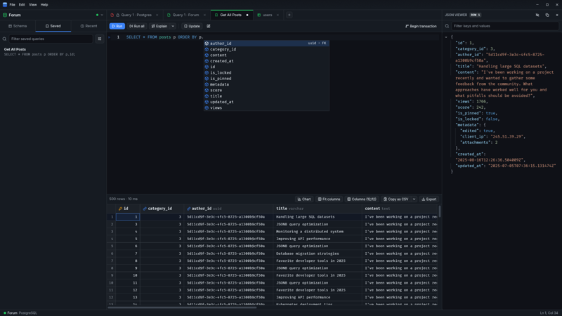</a><br><sub><b>Editor</b></sub></td>
    <td align="center"><a href="docs/screenshots/2.webp">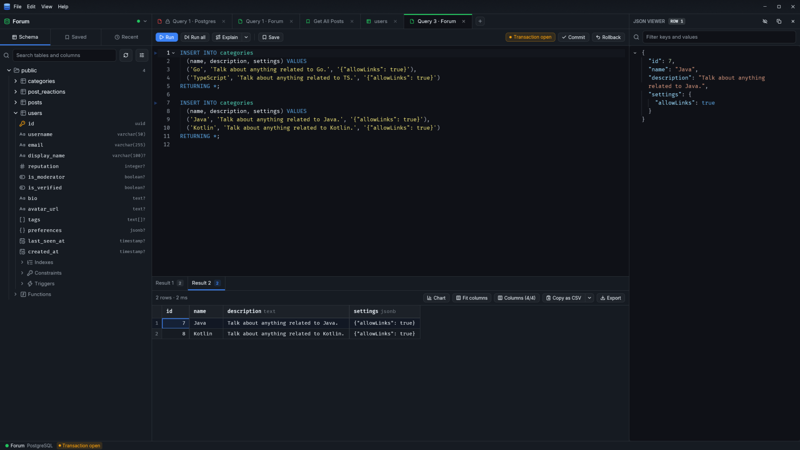</a><br><sub><b>Transactions & multiple results</b></sub></td>
    <td align="center"><a href="docs/screenshots/3.webp">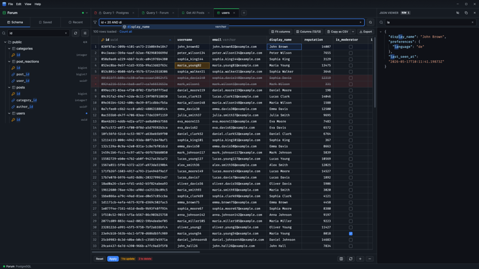</a><br><sub><b>Table data</b></sub></td>
  </tr>
  <tr>
    <td align="center"><a href="docs/screenshots/4.webp">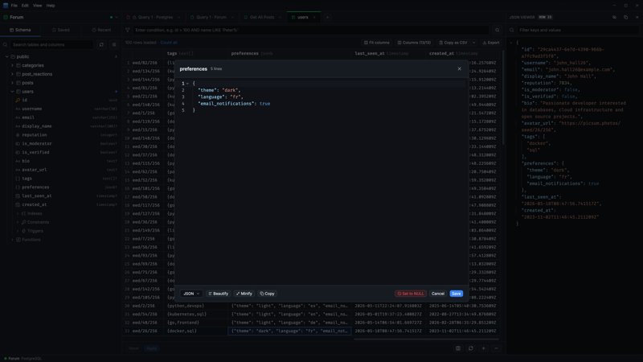</a><br><sub><b>Cell editor</b></sub></td>
    <td align="center"><a href="docs/screenshots/5.webp">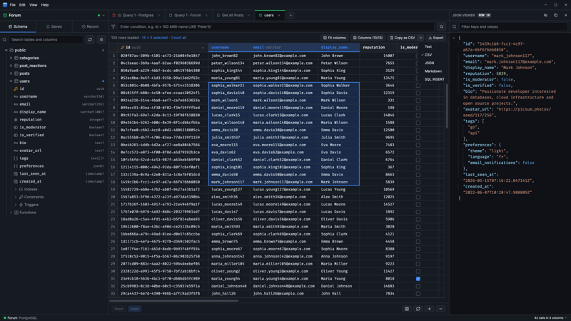</a><br><sub><b>Grid</b></sub></td>
    <td align="center"><a href="docs/screenshots/6.webp">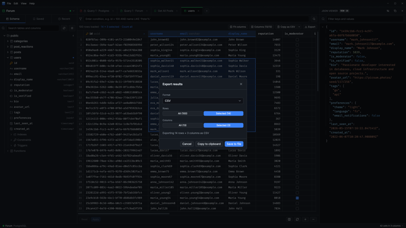</a><br><sub><b>Export</b></sub></td>
  </tr>
  <tr>
    <td align="center"><a href="docs/screenshots/7.webp">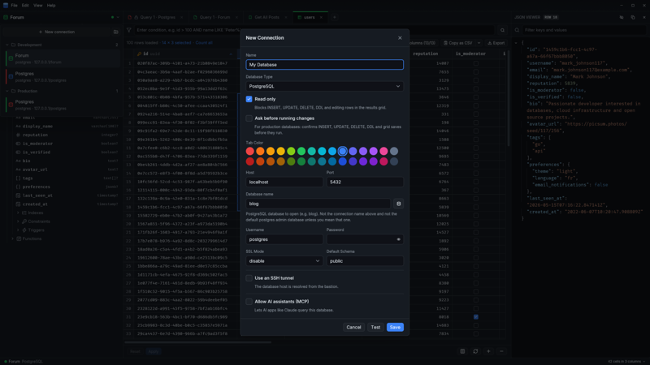</a><br><sub><b>Connections</b></sub></td>
    <td align="center"><a href="docs/screenshots/8.webp">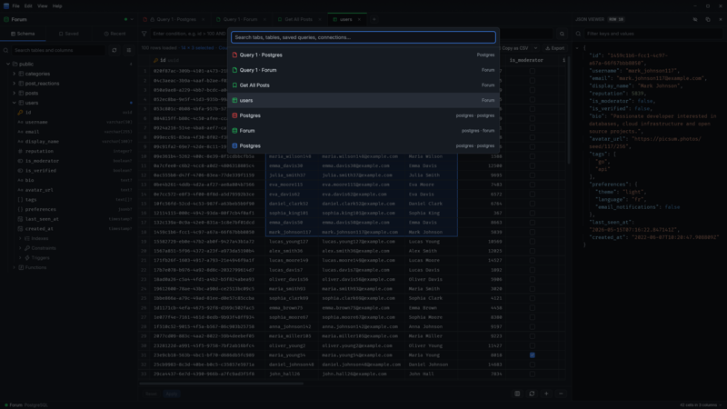</a><br><sub><b>Quick Search</b></sub></td>
    <td align="center"><a href="docs/screenshots/9.webp">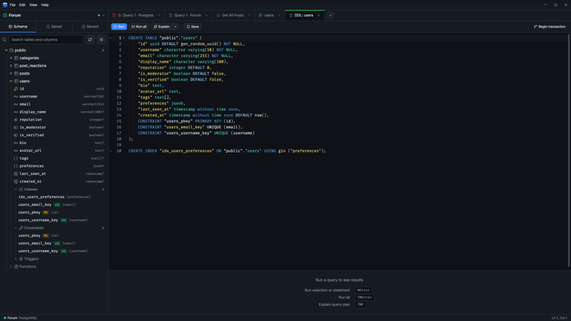</a><br><sub><b>DDL viewer</b></sub></td>
  </tr>
  <tr>
    <td align="center"><a href="docs/screenshots/10.webp">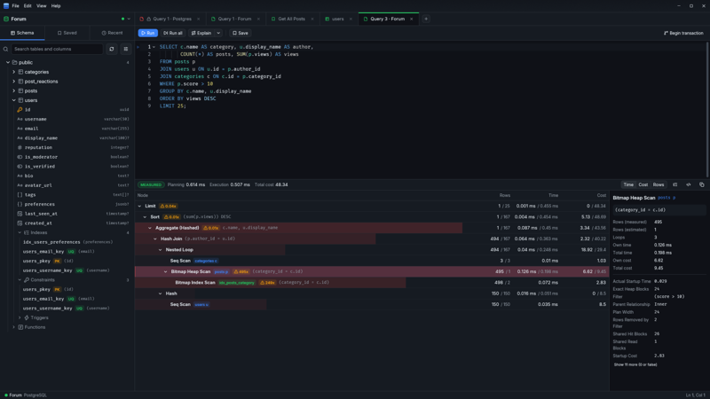</a><br><sub><b>Plan viewer</b></sub></td>
    <td align="center"><a href="docs/screenshots/11.webp">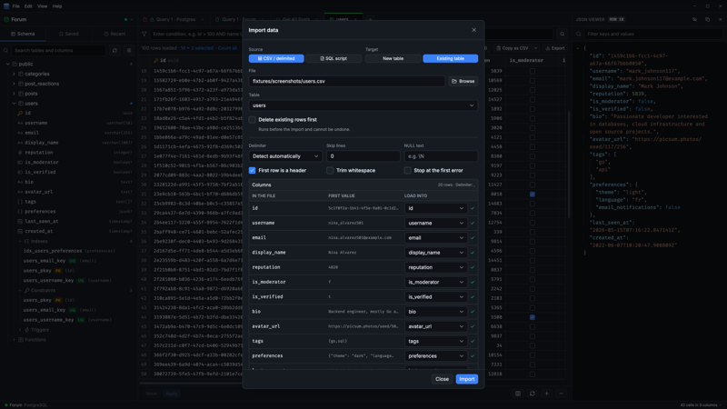</a><br><sub><b>CSV & SQL import</b></sub></td>
    <td align="center"><a href="docs/screenshots/12.webp">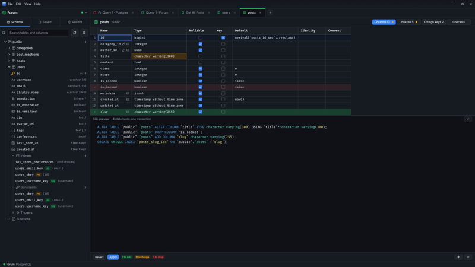</a><br><sub><b>Structure editor</b></sub></td>
  </tr>
  <tr>
    <td align="center"><a href="docs/screenshots/13.webp">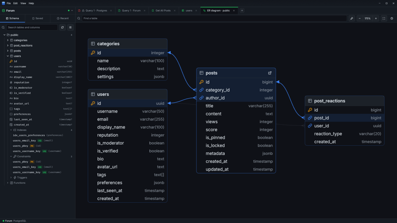</a><br><sub><b>ER diagram</b></sub></td>
    <td align="center"><a href="docs/screenshots/14.webp">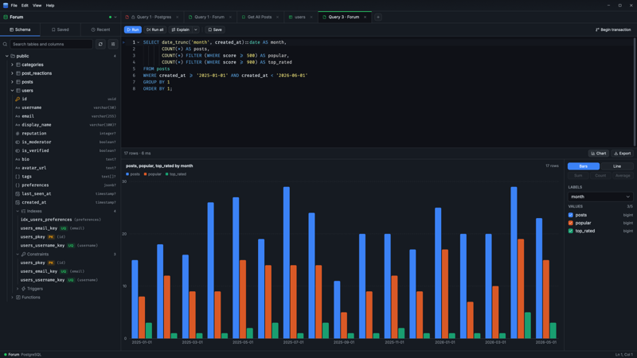</a><br><sub><b>Quick charts</b></sub></td>
    <td align="center"><a href="docs/screenshots/15.webp">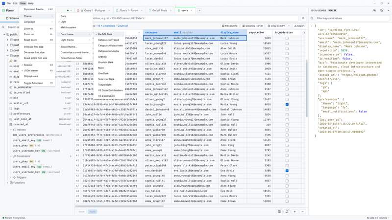</a><br><sub><b>Appearance</b></sub></td>
  </tr>
</table>

---

## ⚡ What BarSQL is

BarSQL is a **desktop SQL client built for developers who want speed, clarity and control**.

It combines:

- 🦀 Rust from the database drivers up to the window
- 🖥️ [GPUI](https://www.gpui.rs/), the GPU-accelerated UI framework behind the Zed editor
- 🧩 [GPUI Kit](https://gpui-kit.com/) components, including a code editor with tree-sitter highlighting
- 🔌 Native drivers for each engine: `tokio-postgres`, `mysql_async`, a bundled SQLite, `tiberius` for SQL Server, and BarSQL's own HTTP clients for ClickHouse and Turso

---

## 🚨 Why it exists

Most SQL tools today are:

- slow to start and heavy on memory
- cloud-connected by default
- tied to subscriptions or accounts
- overloaded with features you don’t use

BarSQL focuses on one thing:

> **A fast, local environment for working with databases.**

---

## 🗄️ Supported Databases

| Database       | Read & write | Read-only mode | Secure transport                            | SSH tunnel |
| -------------- | :----------: | :------------: | :------------------------------------------ | :--------: |
| **PostgreSQL** |      ✅      |       ✅       | SSL - `disable` / `require` / `verify-full` |     ✅     |
| **MySQL**      |      ✅      |       ✅       | TLS                                         |     ✅     |
| **MariaDB**    |      ✅      |       ✅       | TLS                                         |     ✅     |
| **SQLite**     |      ✅      |       ✅       | local file                                  |    n/a     |
| **SQL Server** |      ✅      |       ✅       | TLS - `disable` / `require` / `verify-full` / `strict` (TDS 8.0) | ✅ |
| **ClickHouse** |      ✅      |       ✅       | HTTP or HTTPS - `disable` / `require` / `verify-full` | ✅ |
| **Turso / libSQL** |  ✅      |       ✅       | HTTPS, or HTTP for a local `sqld`           | self-hosted `sqld` |

Per-engine details are in the **[engine notes](guide/connections.md#engine-notes)**.

---

## 📖 User Guide

Every feature in detail, one area per page:

| Page | What it covers |
| ---- | -------------- |
| [🔌 Connections](guide/connections.md) | Folders, read-only mode, SSL and TLS, SSH tunnels, SQLite extensions, engine notes |
| [🧠 SQL Editor](guide/editor.md) | Autocomplete, multiple cursors, scripts, transactions, the query plan viewer, saved queries and history |
| [🗃️ Schema Explorer](guide/schema.md) | The schema tree, ER diagrams, schema compare, Copy DDL, schema changes, the structure editor, table backups |
| [📊 Results Grid](guide/results.md) | Sorting, selection stats, quick charts, the cell and JSON viewers, editing data |
| [📥 Import & Export](guide/import-export.md) | CSV and SQL import, export formats |
| [🤖 AI Assistants (MCP)](guide/ai-assistants.md) | Letting AI apps read your databases, and change them only where you allow it |
| [🌍 The App](guide/app.md) | Themes, languages, palettes, the status bar, keyboard shortcuts, the data folder, auto updates |
| [🎨 Themes](guide/themes.md) | The 20 built-in themes, Select theme…, and making your own |

---

## 🧳 Portable by Design

Everything lives in a single **`BarSQL-data/`** folder. When the app sits somewhere writable, that folder is created **right next to the executable** (beside the `.app` bundle on macOS) - move it to a USB stick, network drive, or another PC and it just works.

What's in it, and where it goes when the app can't write beside itself: **[The App](guide/app.md#-portable-by-design)**.

---

## ⚙️ Build from source

```bash
cargo run -p barsql --release
```

Requirements, tests and the project layout are in **[CONTRIBUTING.md](CONTRIBUTING.md)**, packaging and releases in **[RELEASING.md](RELEASING.md)**.

---

## 🤝 Contributing

Issues and pull requests are welcome. Good places to start:

- **[Report a bug or ask for a feature](../../issues/new/choose)** - especially anything that misbehaves on your engine or server version
- **[Add a language](CONTRIBUTING.md#translations)** - mostly JSON, plus a few lines of Rust to register it

If BarSQL is useful to you, a ⭐ helps other people find it.

---

## 📄 License

GPL-3.0-only; see [LICENSE](LICENSE).
